# FD-tCGA — Sample Demonstration Clips

Qualitative inference demos of **FD-tCGA (ours)**, a lightweight video violence-detection model, on public benchmark clips, next to seven published comparators. Only rendered example outputs are shared here; the code, model details and training setup are not part of this repository.

---

## 1. Introduction

This repository contains **56 short clips** (MP4 + GIF) from the held-out **test** splits of five public benchmarks, plus one real-time demo. **Batch 1** holds rule-selected clips per dataset (best and worst for each class), **Batch 2** best and bad clips under specific conditions (camera motion, brightness, temporal sampling, comparison with the strongest comparators).

**These are pre-rendered visualization clips, not the raw benchmark datasets.** Each `.mp4` is a side-by-side panel:

- **Left** — the clip with FD-tCGA's decision: label and confidence bar, border **red = predicted violent**, **green = predicted non-violent**.
- **Right** — P(violence) over time for **FD-tCGA (ours, solid)** and seven comparators (dashed): KianNet, VGG16-BiGRU, VGG16-LSTM, Attn-Res-LSTM, VGG19-LSTM, Xception-BiLSTM, SE-MobileNet. At every frame each model re-samples its input from the frames seen so far, so the last point equals the model's whole-clip test prediction.

**How the clips were chosen** (fixed rules, no hand-picking). FD-tCGA was trained with three seeds (SURV: five cross-validation folds). *best* = correct for every seed with the highest probability of the true class; *bad* = wrong for the majority of seeds with the most confident error; *hardest* = the least confident correct clip when a dataset has no error of that kind. The videos show the **seed-42** model (SURV: the fold model that had the clip in its test fold, never one trained on it), so a bad case can be correct for seed 42 — the table gives both. ✗ = wrong decision. Long UBI clips are shown uniformly sampled to 360 frames.

---

## 2. Batch 1 — best and bad cases on all five datasets

### Hockey Fight

| Case | Clip | Truth | FD-tCGA 3-seed ptrue (seeds correct) | FD-tCGA (ours) | KianNet | VGG16-BiGRU | VGG16-LSTM | Attn-Res-LSTM | VGG19-LSTM | Xception-BiLSTM | SE-MobileNet |
|:--|:--|:--|--:|--:|--:|--:|--:|--:|--:|--:|--:|
| best violent | [`fi201_xvid.avi`](best_bad_cases/hockey/class_best_true_violent_fi201_xvid.mp4) | Violence | 0.98 (3/3) | **0.98** | 0.98 | 0.99 | 1.00 | 1.00 | 0.99 | 0.92 | 0.41 ✗ |
| best non-violent | [`no28_xvid.avi`](best_bad_cases/hockey/class_best_true_non_violent_no28_xvid.mp4) | Normal | 0.97 (3/3) | **0.04** | 0.02 | 0.01 | 0.00 | 0.01 | 0.01 | 0.01 | 0.11 |
| bad FN (missed violence) | [`fi222_xvid.avi`](best_bad_cases/hockey/class_bad_true_violent_fi222_xvid.mp4) | Violence | 0.04 (0/3) | **0.07 ✗** | 0.03 ✗ | 0.31 ✗ | 0.12 ✗ | 0.10 ✗ | 0.09 ✗ | 0.38 ✗ | 0.97 |
| bad FP (false alarm) | [`no92_xvid.avi`](best_bad_cases/hockey/class_bad_true_non_violent_no92_xvid.mp4) | Normal | 0.02 (0/3) | **0.98 ✗** | 0.98 ✗ | 0.97 ✗ | 0.99 ✗ | 0.99 ✗ | 0.96 ✗ | 0.96 ✗ | 0.85 ✗ |

<table>
<tr>
<td align="center" width="50%">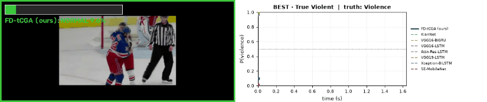 <b>best violent</b> · <code>fi201_xvid.avi</code> (truth: Violence)</td>
<td align="center" width="50%">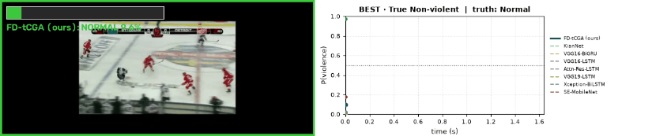 <b>best non-violent</b> · <code>no28_xvid.avi</code> (truth: Normal)</td>
</tr>
<tr>
<td align="center" width="50%">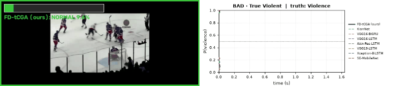 <b>bad FN (missed violence)</b> · <code>fi222_xvid.avi</code> (truth: Violence)</td>
<td align="center" width="50%">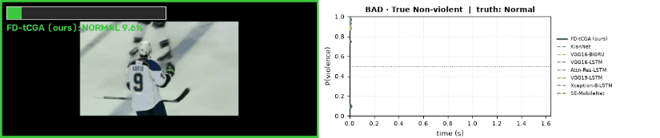 <b>bad FP (false alarm)</b> · <code>no92_xvid.avi</code> (truth: Normal)</td>
</tr>
</table>

### Surveillance Camera Fight (SURV)

| Case | Clip | Truth | FD-tCGA 3-seed ptrue (seeds correct) | FD-tCGA (ours) | KianNet | VGG16-BiGRU | VGG16-LSTM | Attn-Res-LSTM | VGG19-LSTM | Xception-BiLSTM | SE-MobileNet |
|:--|:--|:--|--:|--:|--:|--:|--:|--:|--:|--:|--:|
| best violent | [`fi057.mp4`](best_bad_cases/surv/class_best_true_violent_fi057.mp4) | Violence | 0.99 (CV fold) | **0.99** | 0.93 | 0.66 | 0.67 | 0.77 | 0.65 | 0.50 ✗ | 1.00 |
| best non-violent | [`nofi081.mp4`](best_bad_cases/surv/class_best_true_non_violent_nofi081.mp4) | Normal | 0.99 (CV fold) | **0.01** | 0.04 | 0.40 | 0.40 | 0.04 | 0.17 | 0.46 | 1.00 ✗ |
| bad FN (missed violence) | [`fi071.mp4`](best_bad_cases/surv/class_bad_true_violent_fi071.mp4) | Violence | 0.01 (CV fold) | **0.01 ✗** | 0.02 ✗ | 0.66 | 0.71 | 0.67 | 0.56 | 0.48 ✗ | 0.95 |
| bad FP (false alarm) | [`nofi122.mp4`](best_bad_cases/surv/class_bad_true_non_violent_nofi122.mp4) | Normal | 0.03 (CV fold) | **0.97 ✗** | 0.60 ✗ | 0.04 | 0.00 | 0.42 | 0.07 | 0.50 | 0.99 ✗ |

<table>
<tr>
<td align="center" width="50%">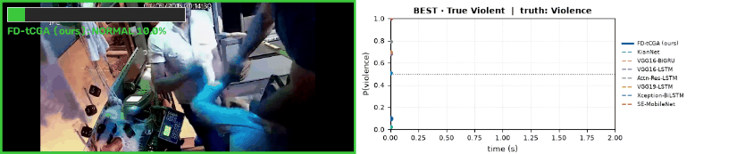 <b>best violent</b> · <code>fi057.mp4</code> (truth: Violence)</td>
<td align="center" width="50%">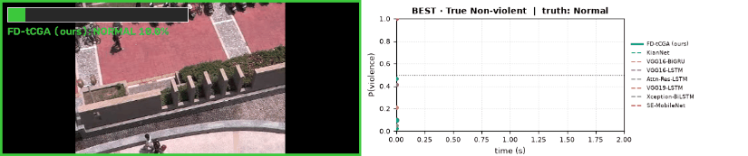 <b>best non-violent</b> · <code>nofi081.mp4</code> (truth: Normal)</td>
</tr>
<tr>
<td align="center" width="50%">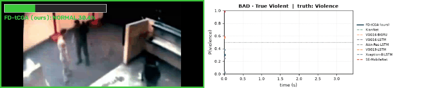 <b>bad FN (missed violence)</b> · <code>fi071.mp4</code> (truth: Violence)</td>
<td align="center" width="50%">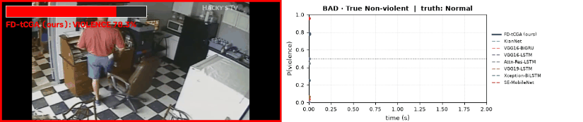 <b>bad FP (false alarm)</b> · <code>nofi122.mp4</code> (truth: Normal)</td>
</tr>
</table>

### RLVS

| Case | Clip | Truth | FD-tCGA 3-seed ptrue (seeds correct) | FD-tCGA (ours) | KianNet | VGG16-BiGRU | VGG16-LSTM | Attn-Res-LSTM | VGG19-LSTM | Xception-BiLSTM | SE-MobileNet |
|:--|:--|:--|--:|--:|--:|--:|--:|--:|--:|--:|--:|
| best violent | [`V_516.mp4`](best_bad_cases/rlvs/class_best_true_violent_V_516.mp4) | Violence | 0.96 (3/3) | **0.96** | 0.97 | 1.00 | 1.00 | 1.00 | 1.00 | 0.96 | 0.70 |
| best non-violent | [`NV_641.mp4`](best_bad_cases/rlvs/class_best_true_non_violent_NV_641.mp4) | Normal | 0.98 (3/3) | **0.03** | 0.04 | 0.00 | 0.00 | 0.00 | 0.00 | 0.00 | 0.79 ✗ |
| bad FN (missed violence) | [`V_669.mp4`](best_bad_cases/rlvs/class_bad_true_violent_V_669.mp4) | Violence | 0.29 (0/3) | **0.06 ✗** | 0.83 | 0.00 ✗ | 0.00 ✗ | 0.01 ✗ | 0.01 ✗ | 0.24 ✗ | 0.02 ✗ |
| bad FP (false alarm) | [`NV_163.mp4`](best_bad_cases/rlvs/class_bad_true_non_violent_NV_163.mp4) | Normal | 0.38 (1/3) | **0.92 ✗** | 0.03 | 0.06 | 0.00 | 0.00 | 0.18 | 0.60 ✗ | 0.17 |

<table>
<tr>
<td align="center" width="50%">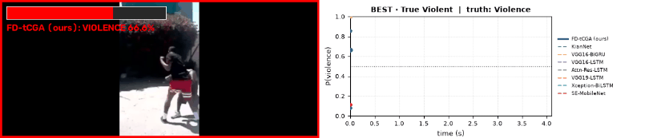 <b>best violent</b> · <code>V_516.mp4</code> (truth: Violence)</td>
<td align="center" width="50%">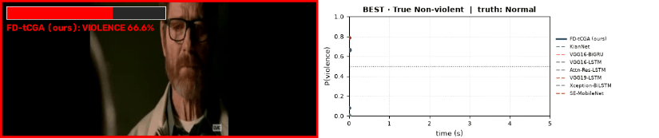 <b>best non-violent</b> · <code>NV_641.mp4</code> (truth: Normal)</td>
</tr>
<tr>
<td align="center" width="50%">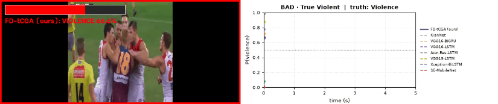 <b>bad FN (missed violence)</b> · <code>V_669.mp4</code> (truth: Violence)</td>
<td align="center" width="50%">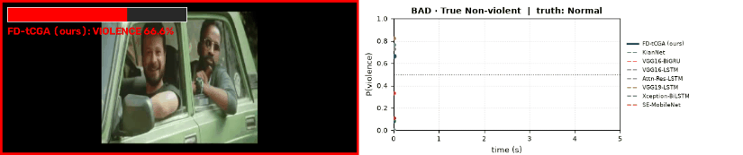 <b>bad FP (false alarm)</b> · <code>NV_163.mp4</code> (truth: Normal)</td>
</tr>
</table>

### RWF-2000

| Case | Clip | Truth | FD-tCGA 3-seed ptrue (seeds correct) | FD-tCGA (ours) | KianNet | VGG16-BiGRU | VGG16-LSTM | Attn-Res-LSTM | VGG19-LSTM | Xception-BiLSTM | SE-MobileNet |
|:--|:--|:--|--:|--:|--:|--:|--:|--:|--:|--:|--:|
| best violent | [`v_RLVS_a_0_1.mp4`](best_bad_cases/rwf2000/class_best_true_violent_v_RLVS_a_0_1.mp4) | Violence | 0.98 (3/3) | **0.98** | 0.98 | 1.00 | 1.00 | 1.00 | 1.00 | 0.99 | 0.91 |
| best non-violent | [`v_BenchPress_g25_c07.avi`](best_bad_cases/rwf2000/class_best_true_non_violent_v_BenchPress_g25_c07.mp4) | Normal | 0.98 (3/3) | **0.02** | 0.04 | 0.00 | 0.01 | 0.00 | 0.00 | 0.01 | 0.54 ✗ |
| bad FN (missed violence) | [`v_FTSN_-_12.mp4`](best_bad_cases/rwf2000/class_bad_true_violent_v_FTSN_-_12.mp4) | Violence | 0.05 (0/3) | **0.02 ✗** | 0.79 | 0.98 | 0.98 | 0.93 | 1.00 | 0.78 | 0.01 ✗ |
| bad FP (false alarm) | [`NV_353.mp4`](best_bad_cases/rwf2000/class_bad_true_non_violent_NV_353.mp4) | Normal | 0.05 (0/3) | **0.95 ✗** | 0.88 ✗ | 0.00 | 0.01 | 0.00 | 0.64 ✗ | 0.13 | 0.34 |

<table>
<tr>
<td align="center" width="50%">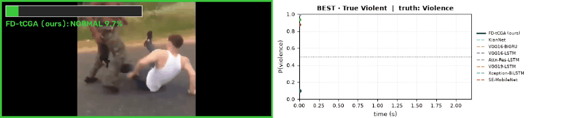 <b>best violent</b> · <code>v_RLVS_a_0_1.mp4</code> (truth: Violence)</td>
<td align="center" width="50%">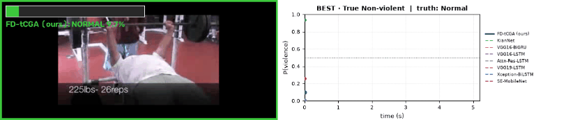 <b>best non-violent</b> · <code>v_BenchPress_g25_c07.avi</code> (truth: Normal)</td>
</tr>
<tr>
<td align="center" width="50%">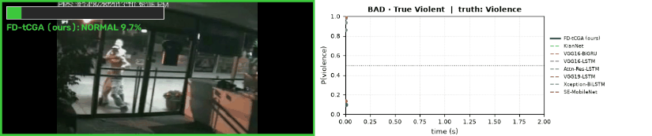 <b>bad FN (missed violence)</b> · <code>v_FTSN_-_12.mp4</code> (truth: Violence)</td>
<td align="center" width="50%">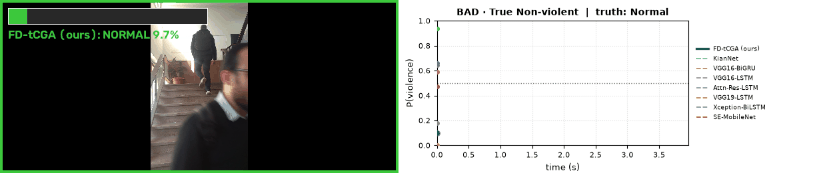 <b>bad FP (false alarm)</b> · <code>NV_353.mp4</code> (truth: Normal)</td>
</tr>
</table>

### UBI-Fights

| Case | Clip | Truth | FD-tCGA 3-seed ptrue (seeds correct) | FD-tCGA (ours) | KianNet | VGG16-BiGRU | VGG16-LSTM | Attn-Res-LSTM | VGG19-LSTM | Xception-BiLSTM | SE-MobileNet |
|:--|:--|:--|--:|--:|--:|--:|--:|--:|--:|--:|--:|
| best violent | [`F_30_1_0_0_0.mp4`](best_bad_cases/ubi/class_best_true_violent_F_30_1_0_0_0.mp4) | Violence | 0.99 (3/3) | **0.99** | 0.99 | 0.97 | 0.36 ✗ | 1.00 | 0.95 | 0.81 | 0.93 |
| best non-violent | [`N_426_0_0_1_0.mp4`](best_bad_cases/ubi/class_best_true_non_violent_N_426_0_0_1_0.mp4) | Normal | 0.92 (3/3) | **0.08** | 0.10 | 0.02 | 0.64 ✗ | 0.01 | 0.70 ✗ | 0.08 | 0.01 |
| bad FN (missed violence) | [`F_156_1_0_1_0.mp4`](best_bad_cases/ubi/class_bad_true_violent_F_156_1_0_1_0.mp4) | Violence | 0.08 (0/3) | **0.09 ✗** | 0.10 ✗ | 0.05 ✗ | 0.05 ✗ | 0.06 ✗ | 0.04 ✗ | 0.21 ✗ | 0.02 ✗ |
| bad FP (false alarm) | [`N_612_1_0_1_0.mp4`](best_bad_cases/ubi/class_bad_true_non_violent_N_612_1_0_1_0.mp4) | Normal | 0.01 (0/3) | **0.99 ✗** | 0.99 ✗ | 0.98 ✗ | 0.82 ✗ | 1.00 ✗ | 0.98 ✗ | 0.88 ✗ | 0.99 ✗ |

<table>
<tr>
<td align="center" width="50%">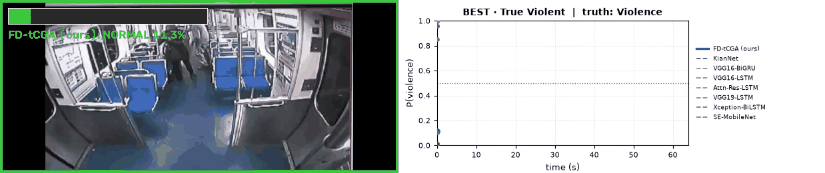 <b>best violent</b> · <code>F_30_1_0_0_0.mp4</code> (truth: Violence)</td>
<td align="center" width="50%">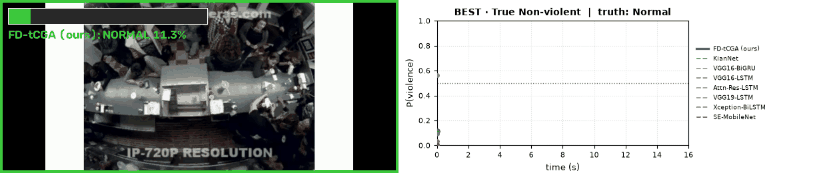 <b>best non-violent</b> · <code>N_426_0_0_1_0.mp4</code> (truth: Normal)</td>
</tr>
<tr>
<td align="center" width="50%">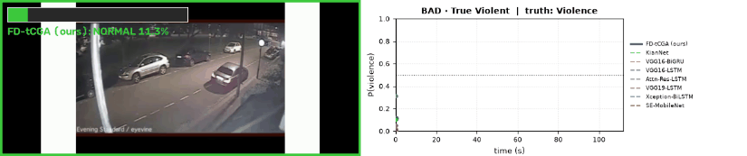 <b>bad FN (missed violence)</b> · <code>F_156_1_0_1_0.mp4</code> (truth: Violence)</td>
<td align="center" width="50%">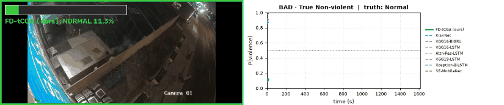 <b>bad FP (false alarm)</b> · <code>N_612_1_0_1_0.mp4</code> (truth: Normal)</td>
</tr>
</table>

---

## 3. Batch 2 — best and bad cases by condition

Conditions: camera ego-motion (lowest / highest tercile of the clip's global-motion score), brightness (darkest / brightest tercile), test-time frame sampling (*robust* / *fragile*: stable / unstable when the frames given to the model change), and FD-tCGA vs. KianNet, VGG16-BiGRU and VGG16-LSTM (*wins* / *loses*).

### Camera ego-motion

| Dataset | Case | Clip | Truth | FD-tCGA 3-seed ptrue (seeds correct) | FD-tCGA (ours) | KianNet | VGG16-BiGRU | VGG16-LSTM | Attn-Res-LSTM | VGG19-LSTM | Xception-BiLSTM | SE-MobileNet |
|:--|:--|:--|:--|--:|--:|--:|--:|--:|--:|--:|--:|--:|
| Hockey Fight | BEST · High camera motion | [`fi143_xvid.avi`](condition_cases/hockey/motion_best_high_camera_motion_fi143_xvid.mp4) | Violence | 0.98 (3/3) | **0.98** | 0.98 | 1.00 | 1.00 | 1.00 | 1.00 | 0.99 | 0.67 |
| Surveillance Camera Fight | BAD · Low camera motion | [`fi092.mp4`](condition_cases/surv/motion_bad_low_camera_motion_fi092.mp4) | Violence | 0.03 (CV fold) | **0.03 ✗** | 0.11 ✗ | 0.55 | 0.58 | 0.29 ✗ | 0.52 | 0.46 ✗ | 1.00 |
| RLVS | HARDEST · Low camera motion | [`V_3.mp4`](condition_cases/rlvs/motion_hardest_low_camera_motion_V_3.mp4) | Violence | 0.59 (2/3) | **0.79** | 0.94 | 0.93 | 0.97 | 0.98 | 0.01 ✗ | 0.83 | 0.36 ✗ |
| RLVS | BEST · High camera motion | [`NV_164.mp4`](condition_cases/rlvs/motion_best_high_camera_motion_NV_164.mp4) | Normal | 0.98 (3/3) | **0.03** | 0.03 | 0.00 | 0.00 | 0.00 | 0.00 | 0.05 | 0.00 |
| RWF-2000 | BEST · Low camera motion | [`v_RLVS_a_1_0.mp4`](condition_cases/rwf2000/motion_best_low_camera_motion_v_RLVS_a_1_0.mp4) | Violence | 0.97 (3/3) | **0.97** | 0.98 | 1.00 | 1.00 | 1.00 | 1.00 | 1.00 | 0.97 |
| RWF-2000 | BEST · High camera motion | [`v_PNCH_h_35.mp4`](condition_cases/rwf2000/motion_best_high_camera_motion_v_PNCH_h_35.mp4) | Violence | 0.98 (3/3) | **0.97** | 0.98 | 1.00 | 1.00 | 1.00 | 1.00 | 0.95 | 0.67 |
| RWF-2000 | BAD · High camera motion | [`NV_361.mp4`](condition_cases/rwf2000/motion_bad_high_camera_motion_NV_361.mp4) | Normal | 0.05 (0/3) | **0.97 ✗** | 0.96 ✗ | 0.87 ✗ | 0.88 ✗ | 0.76 ✗ | 0.11 | 0.01 | 0.18 |
| UBI-Fights | BEST · Low camera motion | [`N_411_0_0_1_0.mp4`](condition_cases/ubi/motion_best_low_camera_motion_N_411_0_0_1_0.mp4) | Normal | 0.92 (3/3) | **0.09** | 0.10 | 0.00 | 0.03 | 0.00 | 0.01 | 0.01 | 0.14 |
| UBI-Fights | BEST · High camera motion | [`F_198_1_1_0_0.mp4`](condition_cases/ubi/motion_best_high_camera_motion_F_198_1_1_0_0.mp4) | Violence | 0.99 (3/3) | **0.99** | 0.99 | 1.00 | 0.94 | 1.00 | 1.00 | 0.80 | 1.00 |
| UBI-Fights | BAD · High camera motion | [`F_55_1_0_0_0.mp4`](condition_cases/ubi/motion_bad_high_camera_motion_F_55_1_0_0_0.mp4) | Violence | 0.26 (1/3) | **0.08 ✗** | 0.14 ✗ | 0.67 | 0.18 ✗ | 0.02 ✗ | 0.92 | 0.87 | 0.19 ✗ |

GIFs

<table>
<tr>
<td align="center" width="50%">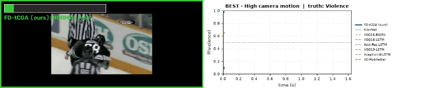 <b>BEST · High camera motion</b> · <code>fi143_xvid.avi</code> (truth: Violence)</td>
<td align="center" width="50%">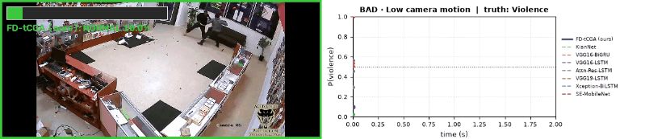 <b>BAD · Low camera motion</b> · <code>fi092.mp4</code> (truth: Violence)</td>
</tr>
<tr>
<td align="center" width="50%">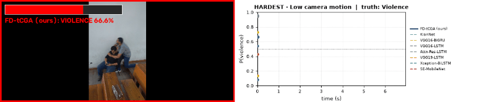 <b>HARDEST · Low camera motion</b> · <code>V_3.mp4</code> (truth: Violence)</td>
<td align="center" width="50%">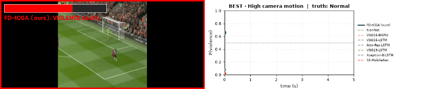 <b>BEST · High camera motion</b> · <code>NV_164.mp4</code> (truth: Normal)</td>
</tr>
<tr>
<td align="center" width="50%">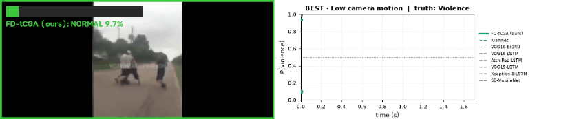 <b>BEST · Low camera motion</b> · <code>v_RLVS_a_1_0.mp4</code> (truth: Violence)</td>
<td align="center" width="50%">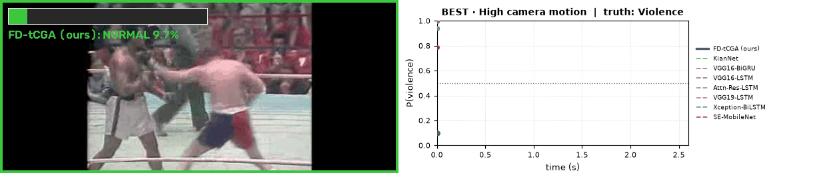 <b>BEST · High camera motion</b> · <code>v_PNCH_h_35.mp4</code> (truth: Violence)</td>
</tr>
<tr>
<td align="center" width="50%">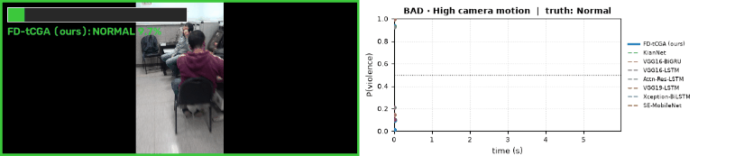 <b>BAD · High camera motion</b> · <code>NV_361.mp4</code> (truth: Normal)</td>
<td align="center" width="50%">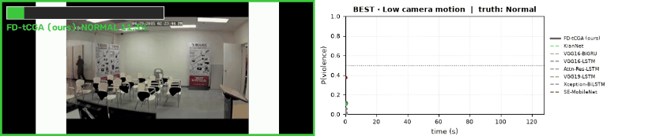 <b>BEST · Low camera motion</b> · <code>N_411_0_0_1_0.mp4</code> (truth: Normal)</td>
</tr>
<tr>
<td align="center" width="50%">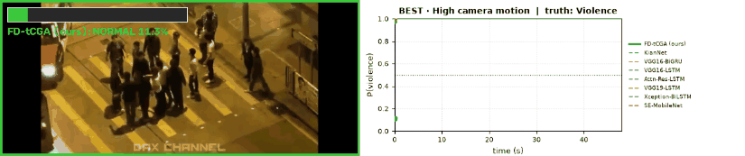 <b>BEST · High camera motion</b> · <code>F_198_1_1_0_0.mp4</code> (truth: Violence)</td>
<td align="center" width="50%">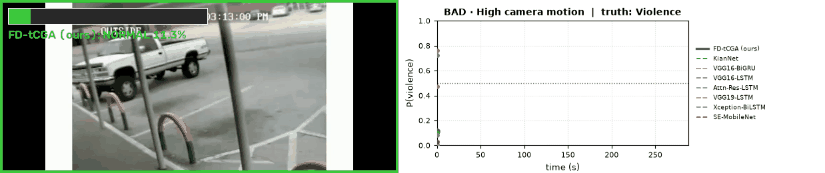 <b>BAD · High camera motion</b> · <code>F_55_1_0_0_0.mp4</code> (truth: Violence)</td>
</tr>
</table>

### Brightness

| Dataset | Case | Clip | Truth | FD-tCGA 3-seed ptrue (seeds correct) | FD-tCGA (ours) | KianNet | VGG16-BiGRU | VGG16-LSTM | Attn-Res-LSTM | VGG19-LSTM | Xception-BiLSTM | SE-MobileNet |
|:--|:--|:--|:--|--:|--:|--:|--:|--:|--:|--:|--:|--:|
| Hockey Fight | BEST · Dark (lowest-brightness tercile) | [`fi158_xvid.avi`](condition_cases/hockey/brightness_best_dark__lowest_brightness_tercile_fi158_xvid.mp4) | Violence | 0.98 (3/3) | **0.98** | 0.98 | 1.00 | 1.00 | 0.99 | 1.00 | 0.99 | 1.00 |
| Hockey Fight | BAD · Dark (lowest-brightness tercile) | [`no269_xvid.avi`](condition_cases/hockey/brightness_bad_dark__lowest_brightness_tercile_no269_xvid.mp4) | Normal | 0.02 (0/3) | **0.98 ✗** | 0.97 ✗ | 0.95 ✗ | 0.98 ✗ | 0.96 ✗ | 0.91 ✗ | 0.98 ✗ | 0.82 ✗ |
| Hockey Fight | BEST · Bright (highest-brightness tercile) | [`fi165_xvid.avi`](condition_cases/hockey/brightness_best_bright__highest_brightness_tercile_fi165_xvid.mp4) | Violence | 0.98 (3/3) | **0.98** | 0.98 | 0.99 | 1.00 | 0.99 | 0.98 | 0.97 | 1.00 |
| Surveillance Camera Fight | BAD · Dark (lowest-brightness tercile) | [`fi136.mp4`](condition_cases/surv/brightness_bad_dark__lowest_brightness_tercile_fi136.mp4) | Violence | 0.03 (CV fold) | **0.03 ✗** | 0.95 | 0.30 ✗ | 0.37 ✗ | 0.05 ✗ | 0.57 | 0.53 | 0.92 |
| Surveillance Camera Fight | BEST · Bright (highest-brightness tercile) | [`fi068.mp4`](condition_cases/surv/brightness_best_bright__highest_brightness_tercile_fi068.mp4) | Violence | 0.99 (CV fold) | **0.99** | 0.99 | 0.56 | 0.57 | 0.73 | 0.68 | 0.50 | 0.99 |
| Surveillance Camera Fight | BAD · Bright (highest-brightness tercile) | [`fi100.mp4`](condition_cases/surv/brightness_bad_bright__highest_brightness_tercile_fi100.mp4) | Violence | 0.02 (CV fold) | **0.02 ✗** | 0.07 ✗ | 0.44 ✗ | 0.47 ✗ | 0.06 ✗ | 0.49 ✗ | 0.48 ✗ | 0.34 ✗ |
| RLVS | BEST · Bright (highest-brightness tercile) | [`NV_731.mp4`](condition_cases/rlvs/brightness_best_bright__highest_brightness_tercile_NV_731.mp4) | Normal | 0.98 (3/3) | **0.03** | 0.08 | 0.00 | 0.00 | 0.00 | 0.00 | 0.04 | 0.92 ✗ |
| RLVS | BAD · Bright (highest-brightness tercile) | [`NV_330.mp4`](condition_cases/rlvs/brightness_bad_bright__highest_brightness_tercile_NV_330.mp4) | Normal | 0.40 (1/3) | **0.68 ✗** | 0.31 | 0.00 | 0.01 | 0.02 | 0.69 ✗ | 0.77 ✗ | 0.00 |
| RWF-2000 | BEST · Bright (highest-brightness tercile) | [`v_FTSN_-_10.mp4`](condition_cases/rwf2000/brightness_best_bright__highest_brightness_tercile_v_FTSN_-_10.mp4) | Violence | 0.97 (3/3) | **0.97** | 0.98 | 1.00 | 1.00 | 1.00 | 1.00 | 0.99 | 0.96 |
| UBI-Fights | BEST · Bright (highest-brightness tercile) | [`F_107_1_2_0_0.mp4`](condition_cases/ubi/brightness_best_bright__highest_brightness_tercile_F_107_1_2_0_0.mp4) | Violence | 0.99 (3/3) | **0.99** | 0.99 | 1.00 | 0.91 | 1.00 | 1.00 | 0.53 | 1.00 |
| UBI-Fights | BAD · Bright (highest-brightness tercile) | [`F_151_0_0_1_0.mp4`](condition_cases/ubi/brightness_bad_bright__highest_brightness_tercile_F_151_0_0_1_0.mp4) | Violence | 0.09 (0/3) | **0.09 ✗** | 0.17 ✗ | 0.00 ✗ | 0.08 ✗ | 0.00 ✗ | 0.01 ✗ | 0.01 ✗ | 0.09 ✗ |

GIFs

<table>
<tr>
<td align="center" width="50%">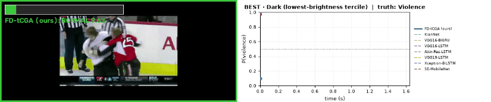 <b>BEST · Dark (lowest-brightness tercile)</b> · <code>fi158_xvid.avi</code> (truth: Violence)</td>
<td align="center" width="50%">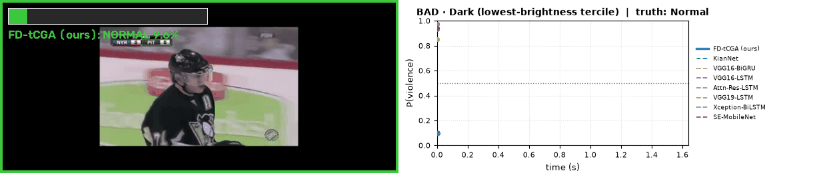 <b>BAD · Dark (lowest-brightness tercile)</b> · <code>no269_xvid.avi</code> (truth: Normal)</td>
</tr>
<tr>
<td align="center" width="50%">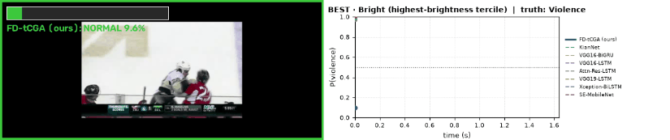 <b>BEST · Bright (highest-brightness tercile)</b> · <code>fi165_xvid.avi</code> (truth: Violence)</td>
<td align="center" width="50%">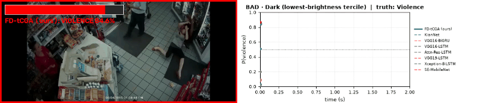 <b>BAD · Dark (lowest-brightness tercile)</b> · <code>fi136.mp4</code> (truth: Violence)</td>
</tr>
<tr>
<td align="center" width="50%">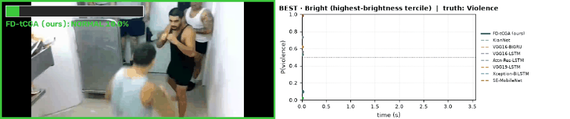 <b>BEST · Bright (highest-brightness tercile)</b> · <code>fi068.mp4</code> (truth: Violence)</td>
<td align="center" width="50%">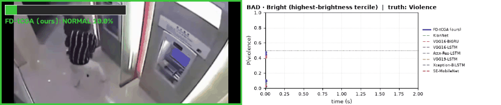 <b>BAD · Bright (highest-brightness tercile)</b> · <code>fi100.mp4</code> (truth: Violence)</td>
</tr>
<tr>
<td align="center" width="50%">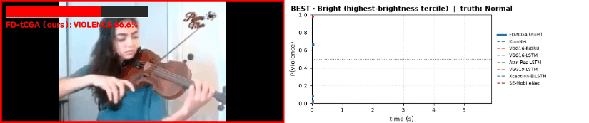 <b>BEST · Bright (highest-brightness tercile)</b> · <code>NV_731.mp4</code> (truth: Normal)</td>
<td align="center" width="50%">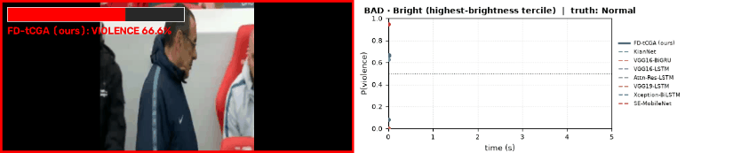 <b>BAD · Bright (highest-brightness tercile)</b> · <code>NV_330.mp4</code> (truth: Normal)</td>
</tr>
<tr>
<td align="center" width="50%">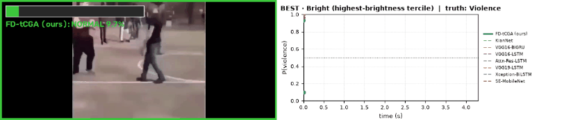 <b>BEST · Bright (highest-brightness tercile)</b> · <code>v_FTSN_-_10.mp4</code> (truth: Violence)</td>
<td align="center" width="50%">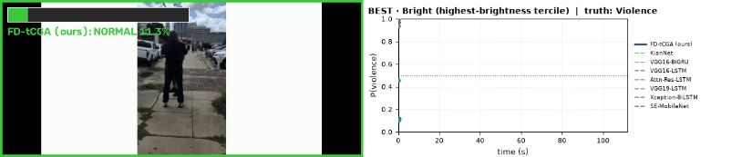 <b>BEST · Bright (highest-brightness tercile)</b> · <code>F_107_1_2_0_0.mp4</code> (truth: Violence)</td>
</tr>
<tr>
<td align="center" width="50%">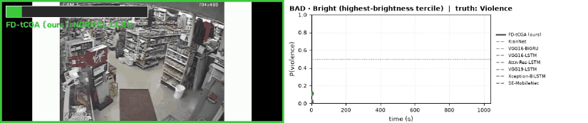 <b>BAD · Bright (highest-brightness tercile)</b> · <code>F_151_0_0_1_0.mp4</code> (truth: Violence)</td>
</tr>
</table>

### Test-time temporal sampling

| Dataset | Case | Clip | Truth | FD-tCGA 3-seed ptrue (seeds correct) | FD-tCGA (ours) | KianNet | VGG16-BiGRU | VGG16-LSTM | Attn-Res-LSTM | VGG19-LSTM | Xception-BiLSTM | SE-MobileNet |
|:--|:--|:--|:--|--:|--:|--:|--:|--:|--:|--:|--:|--:|
| Hockey Fight | ROBUST · Temporal sampling (9 conditions) | [`fi25_xvid.avi`](condition_cases/hockey/temporal_robust_temporal_sampling__9_conditions_fi25_xvid.mp4) | Violence | 0.98 (3/3) | **0.98** | 0.98 | 0.99 | 1.00 | 0.99 | 0.99 | 0.98 | 0.93 |
| Hockey Fight | FRAGILE · Temporal sampling (9 conditions) | [`fi294_xvid.avi`](condition_cases/hockey/temporal_fragile_temporal_sampling__9_conditions_fi294_xvid.mp4) | Violence | 0.66 (2/3) | **0.63** | 0.79 | 0.08 ✗ | 0.03 ✗ | 0.04 ✗ | 0.12 ✗ | 0.09 ✗ | 0.69 |
| Surveillance Camera Fight | ROBUST · Temporal sampling (9 conditions) | [`nofi071.mp4`](condition_cases/surv/temporal_robust_temporal_sampling__9_conditions_nofi071.mp4) | Normal | 0.99 (CV fold) | **0.01** | 0.02 | 0.30 | 0.34 | 0.03 | 0.08 | 0.45 | 1.00 ✗ |
| Surveillance Camera Fight | FRAGILE · Temporal sampling (9 conditions) | [`nofi123.mp4`](condition_cases/surv/temporal_fragile_temporal_sampling__9_conditions_nofi123.mp4) | Normal | 0.67 (CV fold) | **0.33** | 0.95 ✗ | 0.53 ✗ | 0.53 ✗ | 0.68 ✗ | 0.56 ✗ | 0.52 ✗ | 1.00 ✗ |
| RLVS | ROBUST · Temporal sampling (9 conditions) | [`NV_655.mp4`](condition_cases/rlvs/temporal_robust_temporal_sampling__9_conditions_NV_655.mp4) | Normal | 0.98 (3/3) | **0.03** | 0.03 | 0.00 | 0.00 | 0.00 | 0.00 | 0.01 | 0.68 ✗ |
| RLVS | FRAGILE · Temporal sampling (9 conditions) | [`V_721.mp4`](condition_cases/rlvs/temporal_fragile_temporal_sampling__9_conditions_V_721.mp4) | Violence | 0.67 (3/3) | **0.64** | 0.96 | 0.98 | 1.00 | 1.00 | 0.99 | 0.55 | 0.70 |
| RWF-2000 | FRAGILE · Temporal sampling (9 conditions) | [`v_PNCH_h_11.mp4`](condition_cases/rwf2000/temporal_fragile_temporal_sampling__9_conditions_v_PNCH_h_11.mp4) | Violence | 0.59 (2/3) | **0.25 ✗** | 0.96 | 0.98 | 0.86 | 1.00 | 0.85 | 0.76 | 0.36 ✗ |
| UBI-Fights | ROBUST · Temporal sampling (9 conditions) | [`F_14_0_0_0_0.mp4`](condition_cases/ubi/temporal_robust_temporal_sampling__9_conditions_F_14_0_0_0_0.mp4) | Violence | 0.99 (3/3) | **0.99** | 0.99 | 1.00 | 0.98 | 1.00 | 1.00 | 0.98 | 0.83 |
| UBI-Fights | FRAGILE · Temporal sampling (9 conditions) | [`F_153_1_1_0_0.mp4`](condition_cases/ubi/temporal_fragile_temporal_sampling__9_conditions_F_153_1_1_0_0.mp4) | Violence | 0.50 (2/3) | **0.08 ✗** | 0.13 ✗ | 0.78 | 0.24 ✗ | 0.78 | 0.17 ✗ | 0.40 ✗ | 0.00 ✗ |

GIFs

<table>
<tr>
<td align="center" width="50%">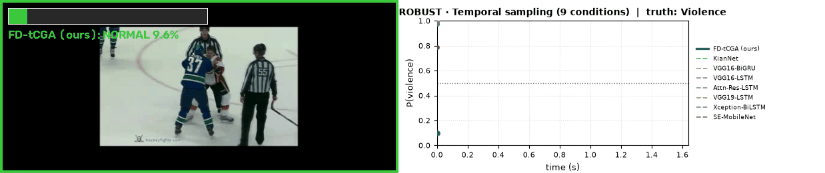 <b>ROBUST · Temporal sampling (9 conditions)</b> · <code>fi25_xvid.avi</code> (truth: Violence)</td>
<td align="center" width="50%">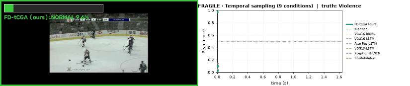 <b>FRAGILE · Temporal sampling (9 conditions)</b> · <code>fi294_xvid.avi</code> (truth: Violence)</td>
</tr>
<tr>
<td align="center" width="50%">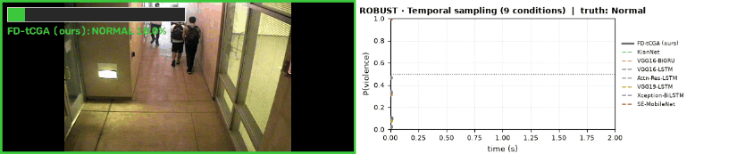 <b>ROBUST · Temporal sampling (9 conditions)</b> · <code>nofi071.mp4</code> (truth: Normal)</td>
<td align="center" width="50%">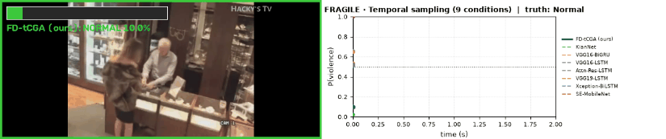 <b>FRAGILE · Temporal sampling (9 conditions)</b> · <code>nofi123.mp4</code> (truth: Normal)</td>
</tr>
<tr>
<td align="center" width="50%">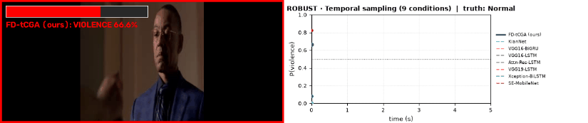 <b>ROBUST · Temporal sampling (9 conditions)</b> · <code>NV_655.mp4</code> (truth: Normal)</td>
<td align="center" width="50%">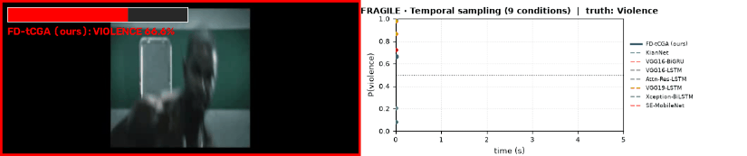 <b>FRAGILE · Temporal sampling (9 conditions)</b> · <code>V_721.mp4</code> (truth: Violence)</td>
</tr>
<tr>
<td align="center" width="50%">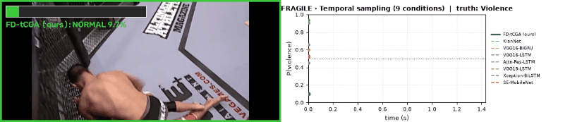 <b>FRAGILE · Temporal sampling (9 conditions)</b> · <code>v_PNCH_h_11.mp4</code> (truth: Violence)</td>
<td align="center" width="50%">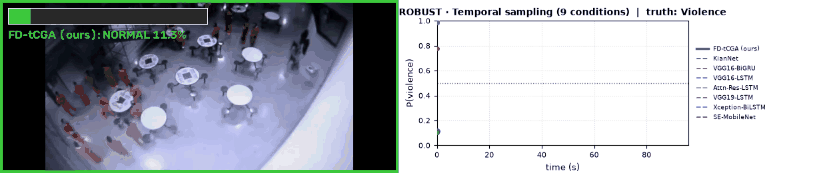 <b>ROBUST · Temporal sampling (9 conditions)</b> · <code>F_14_0_0_0_0.mp4</code> (truth: Violence)</td>
</tr>
<tr>
<td align="center" width="50%">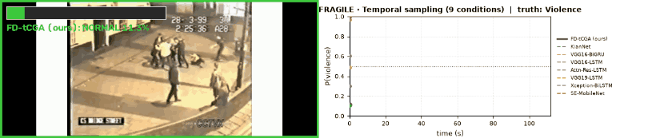 <b>FRAGILE · Temporal sampling (9 conditions)</b> · <code>F_153_1_1_0_0.mp4</code> (truth: Violence)</td>
</tr>
</table>

### FD-tCGA vs. the three strongest comparators

| Dataset | Case | Clip | Truth | FD-tCGA 3-seed ptrue (seeds correct) | FD-tCGA (ours) | KianNet | VGG16-BiGRU | VGG16-LSTM | Attn-Res-LSTM | VGG19-LSTM | Xception-BiLSTM | SE-MobileNet |
|:--|:--|:--|:--|--:|--:|--:|--:|--:|--:|--:|--:|--:|
| Surveillance Camera Fight | FD-TCGA WINS · FD-tCGA vs KianNet / VGG16-BiGRU / VGG16-LSTM | [`fi072.mp4`](condition_cases/surv/compare_fd_tcga_wins_fd_tcga_vs_kiannet___vgg16_bigru___vgg16_lstm_fi072.mp4) | Violence | 0.82 (CV fold) | **0.83** | 0.02 ✗ | 0.12 ✗ | 0.02 ✗ | 0.01 ✗ | 0.40 ✗ | 0.40 ✗ | 0.87 |
| Surveillance Camera Fight | FD-TCGA LOSES · FD-tCGA vs KianNet / VGG16-BiGRU / VGG16-LSTM | [`fi106.mp4`](condition_cases/surv/compare_fd_tcga_loses_fd_tcga_vs_kiannet___vgg16_bigru___vgg16_lstm_fi106.mp4) | Violence | 0.03 (CV fold) | **0.03 ✗** | 0.99 | 0.54 | 0.59 | 0.75 | 0.64 | 0.49 ✗ | 0.97 |
| RLVS | FD-TCGA WINS · FD-tCGA vs KianNet / VGG16-BiGRU / VGG16-LSTM | [`V_398.mp4`](condition_cases/rlvs/compare_fd_tcga_wins_fd_tcga_vs_kiannet___vgg16_bigru___vgg16_lstm_V_398.mp4) | Violence | 0.81 (3/3) | **0.46 ✗** | 0.20 ✗ | 0.55 | 0.30 ✗ | 0.30 ✗ | 0.41 ✗ | 0.52 | 0.28 ✗ |
| RWF-2000 | FD-TCGA WINS · FD-tCGA vs KianNet / VGG16-BiGRU / VGG16-LSTM | [`dntt_ovr_18.avi`](condition_cases/rwf2000/compare_fd_tcga_wins_fd_tcga_vs_kiannet___vgg16_bigru___vgg16_lstm_dntt_ovr_18.mp4) | Normal | 0.66 (3/3) | **0.09** | 0.96 ✗ | 0.46 | 0.62 ✗ | 0.62 ✗ | 0.42 | 0.07 | 0.25 |
| RWF-2000 | FD-TCGA LOSES · FD-tCGA vs KianNet / VGG16-BiGRU / VGG16-LSTM | [`NV_32.mp4`](condition_cases/rwf2000/compare_fd_tcga_loses_fd_tcga_vs_kiannet___vgg16_bigru___vgg16_lstm_NV_32.mp4) | Normal | 0.06 (0/3) | **0.97 ✗** | 0.11 | 0.14 | 0.04 | 0.01 | 0.03 | 0.02 | 1.00 ✗ |
| UBI-Fights | FD-TCGA LOSES · FD-tCGA vs KianNet / VGG16-BiGRU / VGG16-LSTM | [`N_318_0_0_1_0.mp4`](condition_cases/ubi/compare_fd_tcga_loses_fd_tcga_vs_kiannet___vgg16_bigru___vgg16_lstm_N_318_0_0_1_0.mp4) | Normal | 0.33 (1/3) | **0.08** | 0.16 | 0.00 | 0.01 | 0.00 | 0.01 | 0.69 ✗ | 0.01 |

GIFs

<table>
<tr>
<td align="center" width="50%"> <b>FD-TCGA WINS · FD-tCGA vs KianNet / VGG16-BiGRU / VGG16-LSTM</b> · <code>fi072.mp4</code> (truth: Violence)</td>
<td align="center" width="50%"> <b>FD-TCGA LOSES · FD-tCGA vs KianNet / VGG16-BiGRU / VGG16-LSTM</b> · <code>fi106.mp4</code> (truth: Violence)</td>
</tr>
<tr>
<td align="center" width="50%"> <b>FD-TCGA WINS · FD-tCGA vs KianNet / VGG16-BiGRU / VGG16-LSTM</b> · <code>V_398.mp4</code> (truth: Violence)</td>
<td align="center" width="50%"> <b>FD-TCGA WINS · FD-tCGA vs KianNet / VGG16-BiGRU / VGG16-LSTM</b> · <code>dntt_ovr_18.avi</code> (truth: Normal)</td>
</tr>
<tr>
<td align="center" width="50%"> <b>FD-TCGA LOSES · FD-tCGA vs KianNet / VGG16-BiGRU / VGG16-LSTM</b> · <code>NV_32.mp4</code> (truth: Normal)</td>
<td align="center" width="50%"> <b>FD-TCGA LOSES · FD-tCGA vs KianNet / VGG16-BiGRU / VGG16-LSTM</b> · <code>N_318_0_0_1_0.mp4</code> (truth: Normal)</td>
</tr>
</table>

---

## 4. Real-time demo (video file / webcam / RTSP)

The real-time demo runs FD-tCGA on a stream and raises a smoothed alarm.

- Alarm with hysteresis: ON when at least 3 of the last 5 predictions (every 0.5 s) are ≥ 0.6; OFF when all of the last 5 are < 0.4.
- Overlay: state, P(violence), latency and a 30 s probability trace; red border while the alarm is on.
- Logs: every prediction (`windows.csv`) and every alarm (`events.csv`).

**Example run** ([`realtime/realtime_fdtcga_surv.mp4`](realtime/realtime_fdtcga_surv.mp4)): a 22 s stream of 11 SURV test clips of cross-validation fold 0 joined back to back (non-violent / 2 fights / non-violent / 2 fights / non-violent), fold-0 weights, RTX 5060 Ti. Alarms: 5.7–12.4 s (peak 0.78).

**Before real deployment:** the thresholds are uncalibrated defaults. Set them on footage from the target cameras, keep a human in the loop to confirm alarms, and follow local privacy law (e.g. PDPA).

---

## Files

- Clips: H.264 `.mp4`, 10 fps (panel); GIFs are smaller previews of the same clips.
- `results/showcase_manifest.csv` — every clip: dataset, case, truth, P(violence) of all eight models.

> These are rendered outputs (overlays and plot are part of the pixels) and cannot be fed back into a model.

---

## Attribution

The underlying footage is derived from public violence-detection benchmarks. Please cite the original datasets if you use these clips:

- **Hockey Fight** — E. Bermejo Nievas, O. Deniz Suarez, G. Bueno García, R. Sukthankar, *"Violence Detection in Video Using Computer Vision Techniques,"* CAIP, 2011.
- **SURV (Surveillance Camera Fight)** — Ş. Aktı, G. A. Tataroğlu, H. K. Ekenel, *"Vision-based Fight Detection from Surveillance Cameras,"* IPTA, 2019.
- **RLVS (Real-Life Violence Situations)** — M. M. Soliman *et al.,* *"Violence Recognition from Videos Using Deep Learning Techniques,"* ICICIS, 2019.
- **RWF-2000** — M. Cheng, K. Cai, M. Li, *"RWF-2000: An Open Large Scale Video Database for Violence Detection,"* ICPR, 2020. (The copy used here is a composite collection distributed under this name.)
- **UBI-Fights** — B. Degardin, H. Proença, *"Iterative Weak/Self-Supervised Classification Framework for Abnormal Events Detection,"* Pattern Recognition Letters, 2021.

## Citation

> To be added after publication.

## License

> _TODO: add a license. Redistribution of the sample footage may be subject to the terms of the original datasets._
